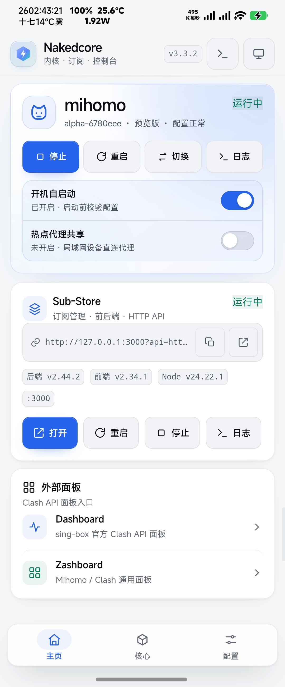
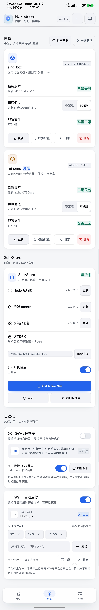
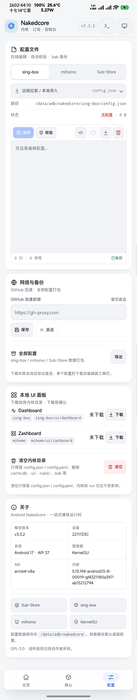
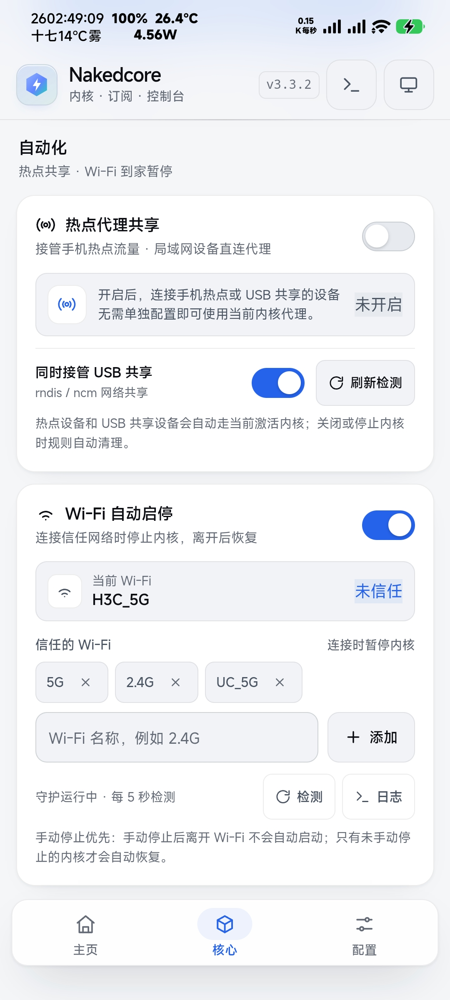
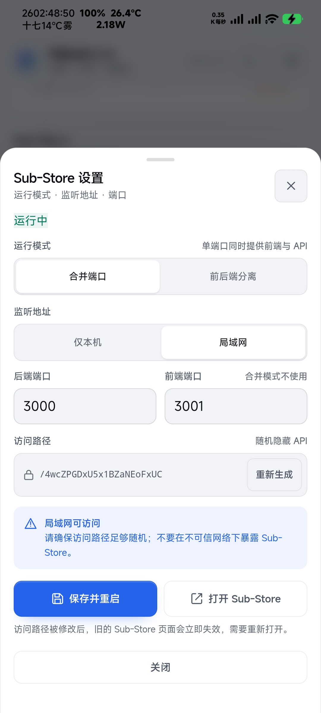
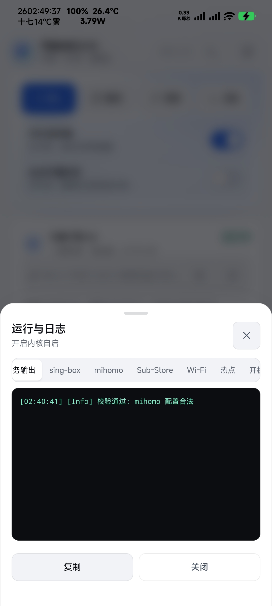
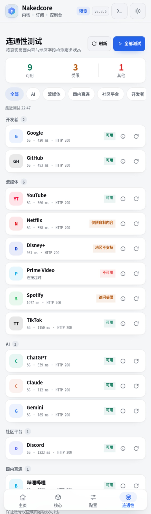

# Android Nakedcore

<p align="center">
  <strong>sing-box / mihomo / Sub-Store / 热点共享，一个可验证的 Android 控制面。</strong>
</p>

<p align="center">
  
  
  
  
</p>

<p align="center">
  <a href="https://github.com/Bcorw/Android_Nakedcore">GitHub 仓库</a> ·
  <a href="#模块使用">安装与使用</a> ·
  <a href="#功能介绍">功能</a>
</p>

## 模块介绍

Android Nakedcore 是一个面向 **Magisk / KernelSU / APatch** 的裸核代理模块，把内核、订阅、配置和网络自动化放进同一套 WebUI 与 CLI。

- **双内核**：sing-box / mihomo 安装、更新、切换、启停、配置校验与回滚
- **订阅管理**：Sub-Store + Node，支持合并端口、前后端分离和随机访问路径
- **配置编辑**：在线编辑、远程拉取、分块上传、保存前校验、`.bak` 备份
- **网络自动化**：Wi-Fi 到家暂停、离家恢复；Root 热点 / USB 共享接管
- **连通性测试**：常用 AI / 流媒体 / 国内 / 社区 / 开发者服务可达性、延迟与出口地区
- **可恢复**：异步任务落盘、运行时副本、终端 wrapper 不依赖 `/system`
- **无内置大二进制**：首次使用时从上游 release 下载 Node / 内核 / Sub-Store

> 当前版本：**v3.3.4** · 已在 Xiaomi 13（fuxi）/ Android 17 / KernelSU 实机验证。

## 界面

实机截图，WebUI 支持深色、浅色和跟随系统。

<p align="center">
  
</p>
<p align="center"><sub>主页：当前内核、Sub-Store、热点与外部面板入口</sub></p>

<p align="center">
  
</p>
<p align="center"><sub>核心：双内核、Sub-Store、Wi-Fi 与热点自动化</sub></p>

<p align="center">
  
</p>
<p align="center"><sub>配置：在线编辑、备份、本地面板与设备信息</sub></p>

<details>
<summary><strong>更多界面：自动化 / Sub-Store 设置 / 运行日志 / 连通性测试</strong></summary>

<p align="center">
  
  
</p>
<p align="center"><sub>自动化 / Sub-Store 设置</sub></p>
<p align="center">
  
</p>
<p align="center"><sub>运行与日志</sub></p>
<p align="center">
  
</p>
<p align="center"><sub>连通性测试</sub></p>

</details>

## 功能介绍

### 内核

- sing-box / mihomo 安装、更新、删除、启停和切换
- 稳定版 / 预览版通道分别记忆
- 启动前校验配置；校验不通过不启动
- 同一时间只运行一个内核，切换失败自动回退
- 更新失败保留 `.old` 二进制并支持回滚
- 查看版本、PID、配置状态、大小和日志

### Sub-Store

- Node、后端 bundle、前端静态包分别安装和更新
- 合并端口（默认单端口）或前后端分离
- 随机 `SUB_STORE_FRONTEND_BACKEND_PATH`，可一键重新生成
- 支持仅本机 / 局域网监听
- 启动、停止、重启、开机自启、直达地址复制/打开
- 端口、模式、访问路径集中配置

### 配置

- 编辑 `sing-box/config.json`、`mihomo/config.yaml`、`sub_store.env`
- 远程 URL / Gist / Sub-Store 输出链接拉取
- JSON / YAML 内容类型防呆，避免把配置写进错误目标
- 本地文件导入、JSON 格式化、分块上传
- 保存前校验；失败可强制保存并明确提示风险
- 自动备份、下载当前配置、导出全部配置

### 网络自动化

- **Wi-Fi 自动启停**：连接信任 Wi-Fi 时暂停内核；离开 Wi-Fi、关闭 Wi-Fi 改用数据流量后恢复
- **手动停止优先**：手动停止后不会被 Wi-Fi 切换自动拉起，`wifi resume` 可恢复
- **热点代理共享**：接管手机 Wi-Fi 热点 / USB 共享，客户端无需单独配置代理
- 热点规则使用独立链 `NC_HS_*`、策略路由 `9000 / 9010` 和本地表 `1888`
- 内核启停、热点开关、守护循环自动同步；关闭或停止内核时幂等清理

### 连通性测试

- 28 个常用服务，按 AI / 流媒体 / 国内直连 / 社区平台 / 开发者分类
- 通过当前系统网络 / TUN 执行 curl，记录 HTTP 状态、延迟和出口地区
- 统计「已完成 / 未解锁 / 其他」，支持分类筛选和单项刷新
- 结果持久化，重新打开 WebUI 仍可查看
- 流媒体「已解锁」只代表 HTTP 可达，不保证内容版权可用

### 本地面板

- Dashboard → `sing-box/ui/dashboard`
- Zashboard → `mihomo/ui/zashboard`
- 下载前二次确认，可单独删除
- 清理时只保留 `config.json` / `config.yaml`，不删除内核和 run 日志

### 任务与日志

- 下载、更新、校验走异步 task，关闭 WebUI 不中断
- 任务结果和日志落盘，WebUI 可轮询查看
- 顶部「运行与日志」统一查看 sing-box、mihomo、Sub-Store、Wi-Fi、热点和开机日志

## 模块使用

### 环境要求

| 项目 | 要求 |
| --- | --- |
| Android | 8.0+，建议 10+ |
| Root | Magisk 20.4+ / KernelSU / APatch |
| 架构 | `arm64-v8a`、`armeabi-v7a`、`x86_64`、`x86` |
| 网络 | 首次安装运行环境需要联网 |

### 安装

1. 下载 `Android_Nakedcore-v3.3.4.zip`；
2. 在 Magisk / KernelSU / APatch 管理器中「从本地安装」；
3. 重启设备，或直接打开模块 WebUI；
4. 进入「核心」页安装 sing-box / mihomo。

**WebUI 入口**：KernelSU / APatch 使用管理器内置 WebUI；Magisk 使用 WebUI X 或 KsuWebUIStandalone。

### 首次使用

1. 安装 sing-box 或 mihomo；
2. 在「配置」页编辑或拉取配置；
3. 可选安装 Sub-Store；
4. 回「主页」启动内核；
5. 需要局域网共享时，在「核心 → 自动化」开启热点代理共享。

### CLI

终端执行 `nakedcore help` 查看全部命令。常用：

```sh
nakedcore status
nakedcore info

nakedcore core start sing-box
nakedcore core stop
nakedcore core switch mihomo
nakedcore core check sing-box
nakedcore core update sing-box stable
nakedcore core rollback sing-box

nakedcore sub start
nakedcore sub update all
nakedcore sub url

nakedcore wifi enable
nakedcore wifi add <base64 SSID>
nakedcore wifi resume

nakedcore hotspot status
nakedcore hotspot enable
nakedcore hotspot usb true
nakedcore hotspot sync
nakedcore hotspot disable

nakedcore connectivity list
nakedcore connectivity results
nakedcore connectivity test
nakedcore connectivity probe openai

nakedcore ui update dashboard
nakedcore ui clear

nakedcore log hotspot 200
nakedcore task current
```

> SSID、代理地址等参数使用 base64 传入，避免引号和特殊字符破坏 shell；WebUI 会自动处理。

### 热点共享

1. 启动当前内核；
2. 打开手机热点（可选开启 USB 共享）；
3. 在 WebUI 开启「热点代理共享」；
4. 查看 `nakedcore hotspot status`，`active=true` 后客户端即可使用。

状态示例：

```json
"hotspot": {
  "enabled": true,
  "active": true,
  "usb": true,
  "ifaces": ["wlan2"],
  "subnet": "10.207.120.0/24"
}
```

热点规则需要 root；不同 ROM 的接口名、TUN 路由表和 DNS 实现可能不同。遇到问题先看：

```sh
nakedcore log hotspot 200
```

> IPv4 转发、NAT 和 DNS 已覆盖；IPv6 只开启 forwarding，数据面取决于内核与 TUN 实现。

### 数据目录

```text
/data/adb/nakedcore
├── bin/                      # sing-box / mihomo / node
├── sing-box/config.json
├── mihomo/config.yaml
├── sub-store/
│   ├── sub-store.bundle.js
│   ├── frontend/
│   └── sub_store.env
├── wifi/                     # 信任 SSID 与手动停止状态
├── runtime/                  # 模块运行时副本
├── settings.conf
├── run/                      # pid、日志、task、临时文件
└── backup/                   # 导出回退目录
```

模块卸载默认保留该目录；配置和 env 权限为 `600`，数据目录为 `700`。

### 升级与卸载

- 覆盖安装会保留 `/data/adb/nakedcore` 下的配置、内核和 Sub-Store 数据；
- 升级后可直接打开 WebUI，不必等待重启；
- 卸载会停止内核、Sub-Store 和网络守护，清理热点规则与终端 wrapper，但保留数据目录；
- 彻底清理：`rm -rf /data/adb/nakedcore`。

### 排障

- **WebUI 空白**：确认管理器支持模块 WebUI，检查 `webroot/index.html`。
- **命令找不到**：使用 `/data/adb/modules/Android_Nakedcore/nakedcore status`，并检查 `/data/adb/ksu/bin/nakedcore`。
- **内核启动失败**：先「校验配置」，再执行 `nakedcore log singbox 200`。
- **Sub-Store 失败**：检查 Node 架构、前后端文件和端口占用。
- **热点未接管**：确认内核运行、热点接口有 IPv4 地址、TUN 存在，并查看 `nakedcore log hotspot`。

### 构建

不需要网络，构建过程不下载二进制：

```sh
./build.sh
# 或覆盖版本名
./build.sh 3.3.4
```

输出：

```text
build/Android_Nakedcore-v3.3.4.zip
```

构建会校验 shell 语法、`webroot/index.html`、`app.js` 和模块入口文件。

### 安全

- Sub-Store 和热点规则以 root 运行；
- Sub-Store 默认只监听 `127.0.0.1`，开放 `0.0.0.0` 前请评估风险；
- 随机访问路径不能替代认证，不要暴露到公网；
- 热点共享会修改 forwarding、策略路由和 iptables，默认关闭。

### 致谢与许可

- [Sub-Store](https://github.com/sub-store-org/Sub-Store) / [Sub-Store-Front-End](https://github.com/sub-store-org/Sub-Store-Front-End)
- [sing-box](https://github.com/SagerNet/sing-box) / [mihomo](https://github.com/MetaCubeX/mihomo)
- [node-android-build](https://github.com/Delusions6515/node-android-build)
- [KernelSU](https://github.com/tiann/KernelSU) / [Magisk](https://github.com/topjohnwu/Magisk) / [APatch](https://github.com/bmax121/APatch)

GPL-3.0。各上游组件版权归其作者所有。
