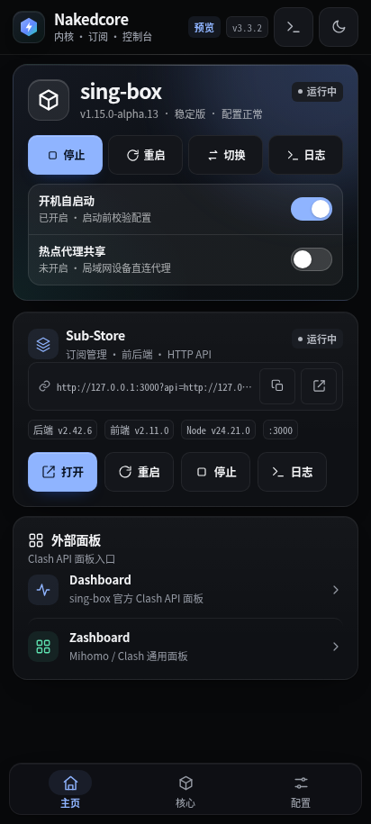
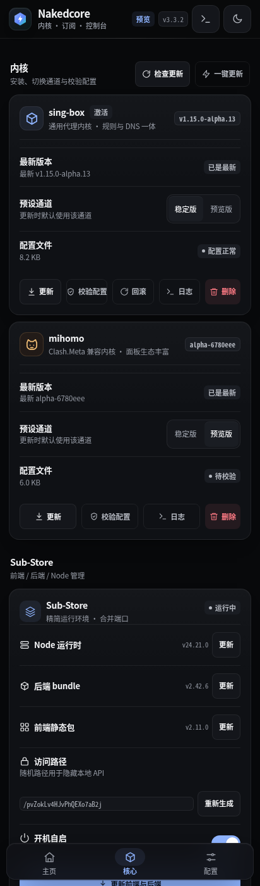
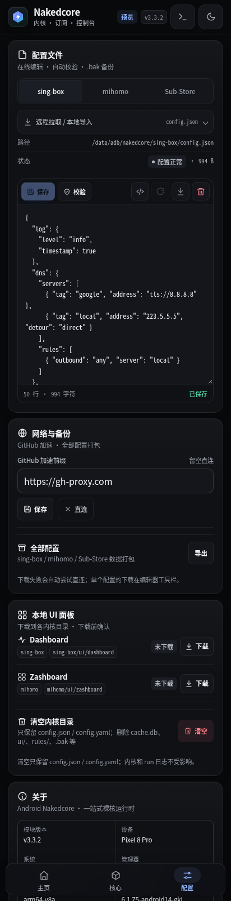
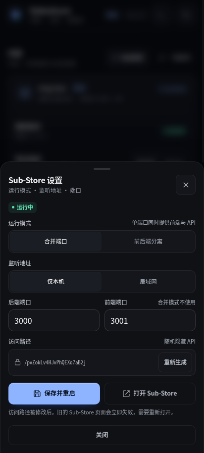
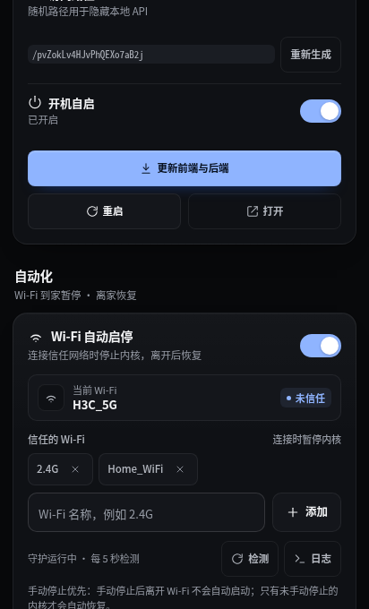

# Android Nakedcore

> 一站式管理 **sing-box / mihomo / Sub-Store** 的 Magisk / KernelSU / APatch 模块。
> 支持按 Wi-Fi 自动启停内核：到家暂停，离家恢复。
> 精简、可校验、可回滚、带完整 WebUI。

Android Nakedcore 把「裸核代理」和「订阅管理」放进同一个模块：

- **sing-box / mihomo**：安装、删除、切换、启动/停止、配置校验、稳定版/预览版通道、失败自动回滚。
- **Sub-Store**：Node / 后端 / 前端一键安装，合并端口（单端口）或前后端分离，随机访问路径，一键更新。
- **配置**：WebUI 在线编辑、远程拉取、分块上传、保存前校验、自动 `.bak` 备份；订阅转换交给 Sub-Store。
- **本地面板**：Dashboard / Zashboard 下载到各内核目录，支持删除与清理缓存。
- **Root 热点共享**：接管手机 Wi-Fi 热点 / USB 共享流量，客户端无需单独配置即可通过当前内核代理上网。
- **开机自启**：先校验配置，通过才启动；避免配置损坏导致开机后设备无网络。
- **Wi-Fi 自动启停**：连接信任 Wi-Fi 时停止内核，离开后自动启动，避免与局域网代理双重接管。
- **异步任务**：更新/下载在后台执行，WebUI 实时查看日志，关闭 WebUI 不影响任务。
- **精简**：不引入原 Sub-Store 模块的 http-meta、inotify、复杂降权链路；只保留实际用到的能力。

## 界面预览

以下截图使用演示数据（`?mock=1`），不包含真实订阅信息。

| 主页 | 核心 | 配置 |
| --- | --- | --- |
|  |  |  |

| Sub-Store 设置 | Wi-Fi 自动启停 |
| --- | --- |
|  |  |

## 为什么重构

旧版 Android_Nakedcore：

- 使用 `/system/bin/nakedcore` overlay，KernelSU 未安装 metamodule 时并不可靠。
- 用 `cmd.queue` + 常驻 shell 守护执行命令，链路长、难排查。
- sing-box / mihomo 版本和下载地址硬编码，很快过期。
- Sub-Store 只实现了很浅的一层：缺少合并/分离模式、Node 安装、完整更新和路径管理。
- WebUI 信息密度低、视觉陈旧，配置编辑器容易丢内容。

v3 的做法：

- CLI 放在模块目录，通过 `/data/adb/{ksu,ap,magisk}/bin/nakedcore` wrapper 调用，**不依赖 `system/` 挂载**。
- 耗时操作统一走异步 task：`task start` → 轮询 `task status`，日志落盘，WebUI 关闭不中断。
- 版本查询优先 GitHub API，失败回退 release 页面 / `version.txt`，避免单一接口限流。
- 下载优先 GitHub 加速地址，失败自动直连；curl 失败会继续尝试 wget / busybox wget。
- Sub-Store 只保留前后端、Node、合并端口、随机路径、更新和日志。
- WebUI 重写为三页（主页 / 核心 / 配置），支持深色/浅色/跟随系统、底部导航、实时运行终端、确认弹层和 Toast。

## 功能

### 内核

- sing-box / mihomo 二进制安装、更新与删除
- 稳定版 / 预览版通道切换（按内核分别记忆）
- 启动前配置校验；校验失败不启动
- 同一时间只运行一个内核；切换时先校验目标，失败自动回退旧内核
- 更新失败自动回滚（保留 `.old` 二进制）
- 查看内核版本、配置状态、大小、PID、日志
- 一键更新当前内核 + Sub-Store

### Wi-Fi 自动启停

- 连接信任 Wi-Fi 时停止当前激活内核，离开后自动启动
- 手动停止优先：手动停止内核后，后续 Wi-Fi 切换不会自动把它拉起；`wifi resume` 可恢复自动逻辑
- 后台守护每 5 秒检测一次，读不到 SSID 时跳过，不做误切换
- 信任 Wi-Fi 精确匹配，可添加多个 SSID（例如家里 2.4G / 5G、办公室）
- 开机时如果当前在信任 Wi-Fi，跳过内核自启
- 自动启停只停止/启动内核，不影响 Sub-Store
- 守护日志在 WebUI 顶栏「运行与日志 → Wi-Fi」或 `nakedcore log wifi`
- 只保存 SSID，不保存 Wi-Fi 密码
- 默认关闭；在「核心 → 自动化」开启
- 只按 SSID 精确匹配，同名 Wi-Fi（例如另一台路由器的 2.4G）也会触发；家里 5G SSID 若与 2.4G 不同，请再添加一条

### Sub-Store（精简）

- Node 运行时自动安装/更新（来自 `Delusions6515/node-android-build`）
- Sub-Store 后端 `sub-store.bundle.js`、前端 `dist.zip` 更新
- 合并端口（默认）或前后端分离
- 随机 `SUB_STORE_FRONTEND_BACKEND_PATH`
- 监听地址：仅本机 / 局域网
- 端口、模式、访问路径快速设置
- 开机自启、启动/停止/重启、日志
- 直达地址复制/打开
- **不包含 http-meta**；需要转换时在 Sub-Store 内生成 `sing-box` / `Clash.Meta` 输出，再把下载链接粘贴到配置页（本模块不追加 `target=`）

### 配置

- 在线编辑 `sing-box/config.json`、`mihomo/config.yaml`、`sub_store.env`
- 保存前自动校验；失败可强制保存（明确风险提示）
- 分块上传，避免超长命令行与特殊字符问题
- 远程 URL 拉取收进编辑器折叠栏；**sing-box** / **mihomo** 各自保存到 `config.json` / `config.yaml`，Sub-Store 环境变量只保留本地导入
- 拉取时增加内容类型防呆：把 mihomo YAML 发到 sing-box，或把 JSON 发到 mihomo，会直接报错而不是写错文件
- 支持 Gist、Sub-Store 下载链接、任意 http(s) 配置直链；不再追加转换参数
- 本地文件导入
- JSON 格式化
- 下载当前配置 / 导出全部配置（`/sdcard/Download/Nakedcore`，失败回退模块 backup 目录）
- 自动 `.bak` 备份
- 运行日志收口到顶栏终端 Sheet，可查看任务输出与各服务日志

### 其他

- GitHub 加速地址设置（留空直连）
- 深色 / 浅色 / 跟随系统主题
- 设备与模块信息
- 中文界面，适配窄屏与手势安全区

## 环境要求

- Android 8.0+（建议 Android 10+）
- Magisk 20.4+ / KernelSU / APatch
- 架构：`arm64-v8a`、`armeabi-v7a`、`x86_64`、`x86`
- 首次安装运行环境需要网络（下载 Node / Sub-Store / 内核）
- WebUI：
  - KernelSU / APatch 管理器内置 WebUI 直接可用
  - Magisk 无内置 WebUI，可使用 KsuWebUIStandalone、WebUI X 等
  - 终端 CLI 在所有管理器下都可用

> Node 来自第三方 Android 构建；sing-box / mihomo / Sub-Store 来自各自 release。
> 本模块不内置大体积二进制，首次使用请到「核心」页安装。

## 安装与升级

1. 下载 `Android_Nakedcore-v3.3.2.zip`
2. 在 Magisk / KernelSU / APatch 管理器中「从本地安装」
3. 重启设备（或直接打开 WebUI）
4. 打开模块 WebUI
5. 首次使用：
   - 「核心」页 → 安装/更新 sing-box 或 mihomo
   - 「核心」页 → Sub-Store → 一键安装运行环境
   - 「配置」页 → 编辑配置或从订阅拉取
   - 「主页」页 → 启动内核 / Sub-Store

### 从 v2 升级

- 数据目录仍是 `/data/adb/nakedcore`，旧内核、配置、Sub-Store 数据与环境变量都会保留。
- 安装时会停止旧的 `nakedcore_daemon_loop`，并移除旧的 `/system/bin` 依赖。
- 旧 `settings.conf` 会补全 `SINGBOX_CHANNEL` / `MIHOMO_CHANNEL`。
- 旧 `sub_store.env` 若缺少 `SUB_STORE_BACKEND_MERGE` / 前端端口，会自动补全。
- 旧 Node / Sub-Store 文件会被识别；无需重新下载。

## 使用说明

### 主页

- 当前激活内核、运行状态、版本、配置状态
- 启动 / 停止 / 重启 / 切换 / 校验 / 日志
- 开机自启开关（开启时会先校验配置）
- Sub-Store 状态、直达地址、启动/停止/重启、更新提示
- Dashboard / Zashboard 外部面板入口
- 运行终端默认隐藏，任务运行时浮现；顶栏终端 Sheet 可查看任务与各服务日志

### 核心

- sing-box / mihomo 卡片：安装、更新、删除、通道、配置校验、回滚、日志
- Sub-Store 卡片：Node / 后端 / 前端版本，分别更新或一键更新
- 「端口与模式」Sheet：模式、监听地址、端口、访问路径
- 检查更新：同时检查 sing-box、mihomo 的稳定/预览版，以及 Sub-Store 前后端
- 一键更新 / 开机日志（顶栏运行与日志）

### 配置

- 文件选择：sing-box / mihomo / Sub-Store 环境变量
- 单行编辑器工具栏：保存 / 校验 + 图标化格式化 / 还原 / 下载 / 删除
- 编辑器内折叠的远程拉取 / 本地导入
- 网络与备份：GitHub 加速 + 全部配置导出
- Wi-Fi 自动启停：信任网络、当前 SSID、守护状态、日志
- 关于：紧凑设备信息

## CLI

终端中执行 `nakedcore help` 查看完整列表。常用：

```sh
# 状态
nakedcore status
nakedcore info

# 内核
nakedcore core start sing-box
nakedcore core stop
nakedcore core restart mihomo
nakedcore core switch mihomo
nakedcore core check sing-box
nakedcore core update sing-box stable
nakedcore core update mihomo alpha
nakedcore core rollback sing-box
nakedcore core delete mihomo
nakedcore autostart true

# Wi-Fi 自动启停
nakedcore wifi status
nakedcore wifi add Mi40Rw==    # base64("2.4G")
nakedcore wifi enable
nakedcore wifi check
nakedcore wifi resume   # 手动停止后恢复自动逻辑
nakedcore wifi remove Mi40Rw==
nakedcore wifi disable

# Sub-Store
nakedcore sub start
nakedcore sub stop
nakedcore sub restart
nakedcore sub update all
nakedcore sub update node
nakedcore sub update backend
nakedcore sub update frontend
nakedcore sub autostart true
nakedcore sub regen-path
nakedcore sub url

# 热点共享
nakedcore hotspot enable
nakedcore hotspot usb true
nakedcore hotspot sync
nakedcore hotspot disable

# 配置
nakedcore cfg get singbox
nakedcore cfg check mihomo
nakedcore cfg download singbox
nakedcore cfg export

# 更新检查 / 一键更新
nakedcore checkup
nakedcore all update

# 本地面板
nakedcore ui update dashboard
nakedcore ui update zashboard
nakedcore ui delete dashboard
nakedcore ui clear

# 日志 / 任务
nakedcore log singbox 200
nakedcore log substore 200
nakedcore log wifi 200
nakedcore log boot 200
nakedcore task start core update sing-box stable
nakedcore task status <id>
nakedcore task current
nakedcore task cancel <id>
```

> 带 base64 参数的子命令主要由 WebUI 使用，避免引号/换行/特殊字符破坏 shell。

## 数据目录

```
/data/adb/nakedcore
├── bin/                      # sing-box / mihomo / node
├── sing-box/
│   ├── config.json
│   └── ui/dashboard/        # Dashboard 本地面板
├── mihomo/
│   ├── config.yaml
│   └── ui/zashboard/        # Zashboard 本地面板
├── sub-store/
│   ├── sub-store.bundle.js
│   ├── frontend/
│   ├── data/
│   └── sub_store.env
├── wifi/
│   ├── ssids                 # 信任 Wi-Fi（每行一个，精确匹配）
│   ├── suspended             # 守护自动停止后的恢复标记
│   └── manual_stop           # 手动停止优先标记（网络切换不自动恢复）
├── settings.conf             # 激活内核 / 自启 / 通道 / 加速地址 / Wi-Fi 守护
├── run/                      # pid、日志、任务、临时文件
└── backup/                   # sdcard 不可用时的导出目录
```

- 模块卸载默认保留该目录。
- 配置和 env 文件权限为 `600`，数据目录 `700`。
- 内置 `/data/adb/{ksu,ap,magisk}/bin/nakedcore` wrapper，可直接在终端调用。

## Sub-Store 说明

### 合并端口（默认）

- 后端同时提供前端页面与 API，默认 `127.0.0.1:3000`。
- 直达地址形如：
  ```
  http://127.0.0.1:3000?api=http://127.0.0.1:3000/<随机路径>
  ```
- 修改端口/模式/路径后需要重启 Sub-Store 生效。

### 前后端分离

- 取消合并模式后，前端使用 `SUB_STORE_FRONTEND_PORT`（默认 3001）。
- 直达地址使用前端端口 + `?api=`：
  ```
  http://127.0.0.1:3001?api=http://127.0.0.1:3001/<随机路径>
  ```

### 访问路径

- `SUB_STORE_FRONTEND_BACKEND_PATH` 默认随机生成（20~24 位字母数字）。
- 泄露后可到「核心」或「配置」页重新生成；旧路径立即失效并自动重启。
- 若改为监听 `0.0.0.0`，请确保路径足够随机，且不要在不可信网络暴露。

### 运行用户

- 当前版本以 **root** 运行 Sub-Store，数据目录在 `/data/adb`，简化权限与 SELinux 问题。
- 如果你要求更低权限，可自行把数据目录迁移到 `/data/local` 并改造启动脚本；当前版本不提供 shell 降权开关。

### 订阅转换

订阅转换是 Sub-Store 的功能，本模块不再在远程拉取时追加 `target=`：

1. 在 Sub-Store 前端添加订阅
2. 生成 sing-box 或 mihomo 格式的输出
3. 复制该输出的下载链接
4. 回到「配置」页，展开「远程拉取 / 本地导入」，粘贴到对应目标并点击「拉取」

远程拉取只负责下载原始配置并校验。校验失败会保留临时文件，并提示是否强制保存。

## 热点代理共享

核心页「自动化」→「热点代理共享」：

- 自动识别 `ap*`、`softap*`、`swlan*`、`wlan1` / `wlan2`，可选 `rndis*` / `ncm*`
- 开启内核 IPv4 / IPv6 转发
- 将热点接口流量策略路由到当前内核 TUN 路由表
- 为热点客户端子网建立本地回程表和规则
- 在 iptables `FORWARD` 放行热点 ↔ TUN，`POSTROUTING` 做 MASQUERADE
- 将热点 DNS 请求重定向到本机 53 端口，并放行本地 DNS
- 内核启动 / 停止 / 重启、热点开关变化、Wi-Fi 守护循环都会自动同步规则
- 关闭开关或停止内核时幂等清理，不残留策略路由 / iptables 规则
- 支持「同时接管 USB 共享」与「刷新检测」

CLI：

```sh
nakedcore hotspot status
nakedcore hotspot enable
nakedcore hotspot disable
nakedcore hotspot usb true|false
nakedcore hotspot sync
```

状态 JSON 新增：

```json
"hotspot": {
  "enabled": true,
  "active": true,
  "usb": true,
  "ifaces": ["ap0"],
  "subnet": "192.168.43.0/24"
}
```

需要 root；设备必须实际提供内核 TUN 和热点接口。规则使用独立链 `NC_HS_*`、策略优先级 9000 / 9010 和本地表 1888，便于清理。

## 本地 UI

「配置」页 →「本地 UI 面板」：

- Dashboard → `sing-box/ui/dashboard`
- Zashboard → `mihomo/ui/zashboard`

下载前会二次确认；已下载时可单独删除，也可「清理 UI 缓存」删除两个内核目录下的 `ui/` 与下载临时文件。清理不会删除 `config.json` / `config.yaml`、内核二进制或日志。

配置中的路径：

```yaml
# mihomo
external-ui: /data/adb/nakedcore/mihomo/ui/zashboard
```

```json
// sing-box experimental.clash_api
"external_ui": "/data/adb/nakedcore/sing-box/ui/dashboard"
```

## 更新与通道

- sing-box：
  - 稳定版：GitHub latest release
  - 预览版：release 列表中的 `alpha` 标签
- mihomo：
  - 稳定版：`releases/latest/download/version.txt`
  - 预览版：`Prerelease-Alpha/version.txt`
- Sub-Store：latest release
- Node：Node.js 当前 LTS 大版本 → `node-android-build` 对应架构 release

下载顺序：

1. 配置了 GitHub 加速地址 → 先走加速
2. 失败 → 直连
3. curl 不可用/失败 → wget / busybox wget

「检查更新」只读取版本，不自动安装；更新需要手动点击。

GitHub 加速前缀会应用到所有 GitHub 下载域名（`github.com`、`codeload`、`raw`、`gist`、`objects`、`api` 等）；远程拉取 Gist 配置也会走加速，失败后自动直连。

## 开机自启

- `service.sh` 在 `sys.boot_completed=1` 后等待 5 秒：
  - 若 `AUTO_START=true`：先校验当前激活内核配置，通过后启动
  - 若 `SUBSTORE_AUTO_START=true`：检查 Node / 后端 / 前端，通过后启动
- 失败原因写入：
  ```
  /data/adb/nakedcore/run/boot.log
  ```
- 管理器 [执行] 按钮：
  - 音量+：启停当前内核
  - 音量-：启停 Sub-Store
  - 8 秒无按键退出

## 故障排查

### WebUI 打不开 / 空白

- 确认使用的是 KernelSU / APatch 管理器，或 Magisk + WebUI X / KsuWebUIStandalone。
- 检查模块目录下 `webroot/index.html` 是否存在。
- 浏览器直接打开 `file://` 不适合排查，请用管理器 WebUI。

### 状态读取失败

- 终端执行：
  ```sh
  nakedcore status
  ```
- 若提示找不到命令：
  ```sh
  /data/adb/modules/Android_Nakedcore/nakedcore status
  ```
- 检查 wrapper：
  ```sh
  ls -l /data/adb/ksu/bin/nakedcore
  ```

### 内核启动失败

1. 「核心」页点击「校验配置」
2. 查看日志：
   ```sh
   nakedcore log singbox 200
   ```
3. 确认端口/TUN/DNS 配置与设备兼容
4. 若刚更新，可点击「回滚」

### Sub-Store 启动失败

```sh
nakedcore sub info
nakedcore log substore 200
```

常见原因：

- Node 未安装 / 架构不匹配
- 后端或前端未下载
- `sub_store.env` 语法错误（WebUI 会校验）
- 端口被占用

### 下载失败

- 在「配置」页设置可用的 GitHub 加速地址，或清空后直连
- sing-box 对重复的 outbound/endpoint tag 是严格拒绝的；如果拉取成功但校验失败，检查配置里是否有重复节点名（常见于多个订阅拼接）
- 终端测试：
  ```sh
  curl -I https://github.com
  ```
- Node 的 `.tar.xz` 解压需要 busybox 的 `xz`/`tar`；KernelSU/Magisk 自带 busybox 通常已包含

### 配置保存后未生效

- 内核：重启内核
- Sub-Store：重启 Sub-Store
- WebUI 会显示「配置已修改 / 环境变量已修改」提示

## 安全说明

- Sub-Store 以 root 运行，数据目录 `/data/adb/nakedcore` 权限 `700`。
- 默认只监听 `127.0.0.1`；改为 `0.0.0.0` 会允许局域网访问，请自行评估风险。
- 默认 CORS 为 `*`，但后端仅在 loopback；若开放局域网，建议改为可信来源。
- 随机访问路径不能替代认证；不要将 Sub-Store 暴露到公网。
- 更新下载自 GitHub / node-android-build，请自行确认上游可信。

## 构建

无需网络即可打包（模块本身不内置二进制）：

```sh
./build.sh
# 或指定版本
./build.sh 3.0.1
```

输出：

```
build/Android_Nakedcore-v3.3.2.zip
```

构建会校验：

- `nakedcore`、`scripts/*.sh`、`webroot/index.html`
- `META-INF/com/google/android/update-binary`
- shell 语法（`sh -n`）

## 卸载

管理器删除模块即可：

- 停止内核、Sub-Store 和旧守护
- 移除 `/data/adb/{ksu,ap,magisk}/bin/nakedcore`
- 保留 `/data/adb/nakedcore` 配置与数据

彻底清理：

```sh
rm -rf /data/adb/nakedcore
```

## 致谢

- [Sub-Store](https://github.com/sub-store-org/Sub-Store) / [Sub-Store-Front-End](https://github.com/sub-store-org/Sub-Store-Front-End)
- [sing-box](https://github.com/SagerNet/sing-box)
- [mihomo](https://github.com/MetaCubeX/mihomo)
- [node-android-build](https://github.com/Delusions6515/node-android-build)
- [Sub-Store-Module](https://github.com/Delusions6515/Sub-Store-Module)：本模块的 Sub-Store 启动/更新思路参考了该项目（GPL-3.0）
- [KernelSU](https://github.com/tiann/KernelSU) / [Magisk](https://github.com/topjohnwu/Magisk) / [APatch](https://github.com/bmax121/APatch)

## 许可

GPL-3.0。组件版权归各自作者所有。
