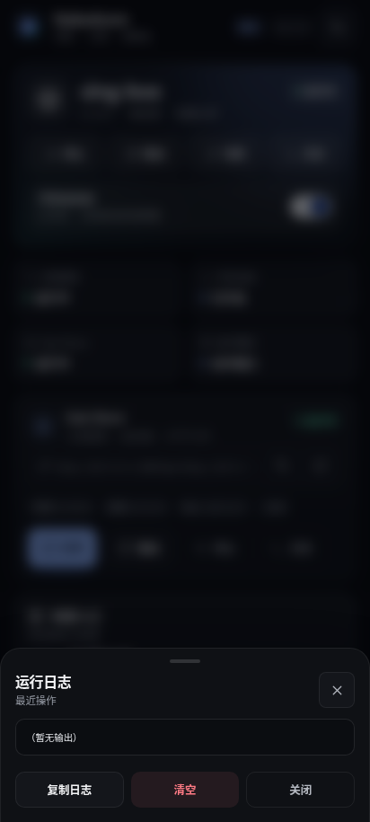

# Android Nakedcore

<p align="center">
  <strong>把 sing-box、mihomo、Sub-Store 和热点共享，收进一个可验证的 Android 控制面。</strong>
</p>

<p align="center">
  
  
  
  
</p>

<p align="center">
  <a href="#快速开始">快速开始</a> ·
  <a href="#界面">界面</a> ·
  <a href="#功能">功能</a> ·
  <a href="#cli">CLI</a> ·
  <a href="#热点代理共享">热点共享</a> ·
  <a href="#数据目录">数据目录</a> ·
  <a href="#排障">排障</a> ·
  <a href="#构建">构建</a>
</p>

Android Nakedcore 是一个面向 **Magisk / KernelSU / APatch** 的裸核代理模块。它不把配置、二进制和网络规则硬编码进一个巨大的安装脚本，而是把每一层拆开：

- **WebUI** 负责状态、操作和反馈；
- **CLI** 负责可复现的命令；
- **异步 task** 负责下载、更新、校验这类耗时操作；
- **脚本层** 负责内核、Sub-Store、Wi-Fi 和热点规则的生命周期；
- **运行时副本** 让模块在尚未重启、甚至模块目录被更新时也能立即使用。

项目地址：**[Bcorw/Android_Nakedcore](https://github.com/Bcorw/Android_Nakedcore)**

---

## 界面

截图使用演示数据（`?mock=1`），不包含真实订阅、配置或 SSID。

| 主页 | 核心 | 配置 |
| :---: | :---: | :---: |
|  |  |  |

| Sub-Store 设置 | Wi-Fi 自动启停 | 运行与日志 |
| :---: | :---: | :---: |
|  |  |  |

WebUI 支持 **深色 / 浅色 / 跟随系统**，适配窄屏、手势安全区和 KernelSU WebView 的底部导航。

---

## 功能

### 内核

- sing-box / mihomo 安装、更新、删除、启停和切换
- 稳定版 / 预览版通道分别记忆
- 启动前校验配置，校验不通过不启动
- 同一时间只运行一个内核；切换失败自动回退
- 更新失败保留并回滚 `.old` 二进制
- 查看版本、PID、配置大小/状态、日志
- 一键检查更新，一键更新当前内核 + Sub-Store

### Sub-Store

- Node 运行时、后端 bundle、前端静态包分别安装/更新
- 合并端口（默认单端口）或前后端分离
- 随机后端访问路径，可一键重新生成
- 监听 `127.0.0.1` 或局域网地址
- 启动、停止、重启、开机自启、直接打开
- 端口、模式、访问路径集中设置
- 不引入 http-meta、inotify 等额外链路，保持精简

### 配置

- 在线编辑 `sing-box/config.json`、`mihomo/config.yaml`、`sub_store.env`
- 保存前校验；失败时明确提示风险，可选择强制保存
- 分块上传，避免超长命令和特殊字符问题
- 远程 URL / Gist / Sub-Store 输出链接拉取
- 内容类型防呆：JSON 不会误写进 mihomo，YAML 不会误写进 sing-box
- 本地文件导入、JSON 格式化
- 自动 `.bak` 备份
- 下载当前配置 / 导出全部配置
- 任务日志与各服务日志统一收进顶栏「运行与日志」

### 网络自动化

- **Wi-Fi 自动启停**：连接信任 Wi-Fi 时暂停内核，离开后恢复
- **手动停止优先**：手动停止内核后，Wi-Fi 切换不会自动拉起；`wifi resume` 恢复
- **热点代理共享**：把手机热点 / USB 共享流量接到当前内核 TUN
- 每个网络动作都有独立日志，默认可关闭，不改变未开启时的网络行为

### 运行与恢复

- 异步 task：下载、解压、更新、校验不阻塞 WebUI
- WebUI 关闭不影响任务；任务结果落盘
- 模块更新后自动生成 `/data/adb/nakedcore/runtime` 副本
- `/data/adb/{ksu,ap,magisk}/bin/nakedcore` wrapper 不依赖 `/system` 挂载
- 安装/升级保留 `/data/adb/nakedcore` 下的配置与数据

---

## 快速开始

### 环境要求

| 项目 | 要求 |
| --- | --- |
| Android | 8.0+，建议 Android 10+ |
| Root 管理器 | Magisk 20.4+ / KernelSU / APatch |
| 架构 | `arm64-v8a`、`armeabi-v7a`、`x86_64`、`x86` |
| 网络 | 首次安装运行环境需要联网 |
| Root | 热点共享、iptables、策略路由需要 root |

> 模块不内置 Node、sing-box、mihomo 和 Sub-Store 大体积二进制，首次使用时从上游 release 下载。

### 安装

1. 下载模块 zip（当前为 `Android_Nakedcore-v3.3.2.zip`）；
2. 在 Magisk / KernelSU / APatch 管理器中「从本地安装」；
3. 重启设备，或直接打开模块 WebUI；
4. 进入「核心」页安装运行环境。

### 首次使用

1. 安装 sing-box 或 mihomo；
2. 在「配置」页编辑配置，或从订阅链接拉取；
3. 安装 Sub-Store（可选）；
4. 回到「主页」启动内核；
5. 需要局域网共享时，在「核心 → 自动化」开启热点代理共享。

### WebUI 入口

- **KernelSU / APatch**：管理器内置 WebUI；
- **Magisk**：使用 WebUI X、KsuWebUIStandalone 等支持模块 WebUI 的管理器；
- **终端**：所有管理器下都可以直接执行 `nakedcore help`。

---

## 热点代理共享

这是 v3.3 新增的重点能力。目标不是“让手机自己走代理”，而是让**连接到手机热点的其他设备**无需单独配置代理，流量直接经过当前内核。

### 工作方式

1. 检测热点 / USB 共享接口；
2. 找到当前内核的 TUN 接口和实际路由表；
3. 开启 IPv4 / IPv6 forwarding；
4. 把热点客户端子网路由到 TUN 路由表；
5. 用 iptables 放行热点 ↔ TUN，并做 MASQUERADE；
6. 将热点 DNS 请求重定向到本机 53 端口；
7. 内核启停、热点开关、守护循环自动同步；
8. 关闭开关或停止内核时幂等清理。

### 检测范围

- Wi-Fi 热点：`ap*`、`softap*`、`swlan*`、`wlan1`、`wlan2`
- USB 共享：`rndis*`、`ncm*`（可通过开关关闭）
- TUN：`tun*`、`Meta`、`utun*`、`mihomo*`、`sing-box*`

不同厂商的接口名可能不同；规则优先使用实际存在且带 IPv4 地址的接口。

### 规则模型

| 类型 | 内容 |
| --- | --- |
| 策略路由 | `pref 9000`：热点子网回到本地表 `1888` |
| 策略路由 | `pref 9010`：热点接口进入 TUN 路由表 |
| 本地回程 | `table 1888` 保存热点子网到热点接口的路由 |
| 转发 | `NC_HS_FWD`：热点 ↔ TUN |
| NAT | `NC_HS_NAT`：热点子网 MASQUERADE 到 TUN |
| DNS | `NC_HS_DNS`：UDP/TCP 53 REDIRECT 到本机 53 |
| 输入 | `NC_HS_IN`：允许热点侧 DNS |

规则使用独立链和固定优先级，清理时不会误删系统的 tethering 规则。

### 真机验证

已在 **Xiaomi 13（fuxi）/ Android 17 / KernelSU** 实机上验证：

- 软热点接口：`wlan2`
- 热点网段：`10.207.120.0/24`
- TUN：`Meta`
- TUN 路由表：`2022`
- 开启后 `hotspot.active=true`，规则实际注入
- 停止内核后规则、状态、forwarding 状态清理
- 关闭热点开关后守护停止
- 守护与手动 sync 并发时使用 `flock` 串行化，避免规则短暂不完整

> 规则链已实际验证；不同 ROM 的 TUN 路由表、DNS 监听方式和热点实现可能不同。首次开启前请确认设备能正常创建热点，并查看 `nakedcore log hotspot`。
>
> IPv4 的转发、NAT 和 DNS 已覆盖；IPv6 只开启 forwarding，IPv6 数据面是否可用取决于内核和 TUN 实现。

### 使用

WebUI：**核心 → 自动化 → 热点代理共享**。

CLI：

```sh
nakedcore hotspot status
nakedcore hotspot enable
nakedcore hotspot disable
nakedcore hotspot usb true|false
nakedcore hotspot sync
```

状态 JSON：

```json
"hotspot": {
  "enabled": true,
  "active": true,
  "usb": true,
  "ifaces": ["wlan2"],
  "subnet": "10.207.120.0/24"
}
```

---

## CLI

终端执行：

```sh
nakedcore help
```

### 状态与内核

```sh
nakedcore status
nakedcore info
nakedcore version

nakedcore core start [sing-box|mihomo]
nakedcore core stop [sing-box|mihomo]
nakedcore core restart <sing-box|mihomo>
nakedcore core switch <sing-box|mihomo>
nakedcore core check [sing-box|mihomo]
nakedcore core update <sing-box|mihomo> [stable|alpha]
nakedcore core rollback <sing-box|mihomo>
nakedcore core delete <sing-box|mihomo>
nakedcore core info [sing-box|mihomo]
nakedcore core latest <sing-box|mihomo> [stable|alpha]
nakedcore autostart <true|false>
```

### Wi-Fi 自动启停

```sh
nakedcore wifi status
nakedcore wifi enable
nakedcore wifi disable
nakedcore wifi check
nakedcore wifi add <base64 SSID>
nakedcore wifi remove <base64 SSID>
nakedcore wifi resume
nakedcore wifi start
nakedcore wifi stop
```

> SSID 使用 base64 传入，避免空格、引号和非 ASCII 字符破坏 shell。WebUI 会自动处理。

### 热点共享

```sh
nakedcore hotspot status
nakedcore hotspot enable
nakedcore hotspot disable
nakedcore hotspot usb true|false
nakedcore hotspot sync
```

### Sub-Store

```sh
nakedcore sub start
nakedcore sub stop
nakedcore sub restart
nakedcore sub update all
nakedcore sub update node
nakedcore sub update backend
nakedcore sub update frontend
nakedcore sub autostart true|false
nakedcore sub regen-path
nakedcore sub set <KEY> <base64值>
nakedcore sub ensure-env
nakedcore sub info
nakedcore sub url
```

### 配置

```sh
nakedcore cfg get <singbox|mihomo|substore>
nakedcore cfg check <target>
nakedcore cfg put <target> <分块序号> <base64>
nakedcore cfg commit <target> [1]
nakedcore cfg reset <target>
nakedcore cfg delete <target>
nakedcore cfg fetch <target> <base64URL> <base64目标格式> [1]
nakedcore cfg download <target>
nakedcore cfg export
```

### 更新检查

```sh
nakedcore checkup
nakedcore all update
nakedcore set GH_PROXY <base64值>
nakedcore set SINGBOX_CHANNEL <base64值>
nakedcore set MIHOMO_CHANNEL <base64值>
```

### 本地面板

```sh
nakedcore ui update dashboard
nakedcore ui update zashboard
nakedcore ui delete dashboard
nakedcore ui clear
```

`ui clear` 会保留 `config.json` / `config.yaml`，删除两个内核目录下的 `ui/`、`cache.db`、`rules/`、`.bak` 和下载临时文件；不删除内核二进制与 run 日志。

### 任务与日志

```sh
nakedcore task start <命令...>
nakedcore task status [id]
nakedcore task current
nakedcore task last
nakedcore task cancel <id>
nakedcore task log <id> [行数]

nakedcore log <singbox|mihomo|substore|wifi|hotspot|boot> [行数]
nakedcore log clear <singbox|mihomo|substore|wifi|hotspot|boot>
```

`nakedcore task start` 返回任务 ID；WebUI 使用 `task status` 轮询，不依赖长连接。

---

## 架构

```text
┌──────────────────────────────────────────┐
│              WebUI (webroot/)            │
│  主页 / 核心 / 配置 / 运行与日志 / 弹层   │
└────────────────────┬─────────────────────┘
                     │  CLI JSON + task
┌────────────────────▼─────────────────────┐
│         nakedcore CLI / runtime          │
│  status  core  sub  wifi  hotspot  cfg   │
└──────┬──────────────┬──────────────┬─────┘
       │              │              │
┌──────▼──────┐ ┌─────▼──────┐ ┌─────▼──────┐
│  scripts/    │ │  scripts/  │ │  scripts/  │
│  core.sh     │ │ substore.sh│ │ wifi.sh    │
│  config.sh   │ │ task.sh    │ │ hotspot.sh │
└──────┬───────┘ └─────┬──────┘ └─────┬──────┘
       │               │              │
  sing-box/mihomo   Node/Sub-Store   iptables/ip rule
       │               │              │
       └───────────────┴──────────────┘
                 /data/adb/nakedcore
```

### 为什么用运行时副本

模块安装目录可能位于 `modules_update`，升级后尚未重启时不可直接执行。安装时会生成：

```text
/data/adb/nakedcore/runtime/nakedcore
/data/adb/nakedcore/runtime/scripts/
/data/adb/nakedcore/runtime/module.prop
```

终端 wrapper 指向这个持久副本：

```sh
exec /data/adb/nakedcore/runtime/nakedcore "$@"
```

因此升级后可以立刻打开 WebUI 或执行 CLI，不必等待重启。

### 任务模型

耗时操作不会占用 WebUI 请求：

1. WebUI 调用 `task start`；
2. CLI 启动子进程并写入 `run/tasks/<id>`；
3. WebUI 轮询 `task status <id>`；
4. 任务日志落盘，WebUI 关闭不中断；
5. 任务结束后写入成功 / 失败状态。

---

## 数据目录

```text
/data/adb/nakedcore
├── bin/                      # sing-box / mihomo / node
├── sing-box/
│   ├── config.json
│   └── ui/dashboard/         # Dashboard 本地面板
├── mihomo/
│   ├── config.yaml
│   └── ui/zashboard/         # Zashboard 本地面板
├── sub-store/
│   ├── sub-store.bundle.js
│   ├── frontend/
│   ├── data/
│   └── sub_store.env
├── wifi/
│   ├── ssids                 # 信任 Wi-Fi，每行一个
│   ├── suspended             # 自动暂停标记
│   └── manual_stop           # 手动停止优先标记
├── runtime/                  # 模块运行时副本
├── settings.conf             # 激活内核 / 自启 / 通道 / 加速地址
├── run/                      # pid、日志、任务、临时文件
│   ├── boot.log
│   ├── wifi.log
│   ├── hotspot.log
│   └── tasks/
└── backup/                   # 导出回退目录
```

- 模块卸载默认保留 `/data/adb/nakedcore`。
- `settings.conf`、`sub_store.env` 权限为 `600`，数据目录为 `700`。
- 终端 wrapper 位于 `/data/adb/{ksu,ap,magisk}/bin/nakedcore`。

---

## Sub-Store 说明

### 合并端口（默认）

后端同时提供前端页面和 API，默认监听 `127.0.0.1:3000`：

```text
http://127.0.0.1:3000?api=http://127.0.0.1:3000/<随机路径>
```

### 前后端分离

关闭合并模式后，前端默认使用 `3001`：

```text
http://127.0.0.1:3001?api=http://127.0.0.1:3001/<随机路径>
```

### 访问路径

`SUB_STORE_FRONTEND_BACKEND_PATH` 默认随机生成。修改或点击「重新生成」后，旧路径立即失效，并自动重启 Sub-Store。

### 运行用户

当前版本以 **root** 运行 Sub-Store，数据目录在 `/data/adb`，简化权限和 SELinux 处理。模块不提供 shell 降权开关。

### 订阅转换

订阅转换属于 Sub-Store：

1. 在 Sub-Store 前端添加订阅；
2. 生成 sing-box / mihomo 格式输出；
3. 复制输出链接；
4. 回到「配置」页，粘贴到对应目标并拉取。

Nakedcore 的远程拉取只负责下载和校验，不追加 `target=` 参数。

---

## 更新机制

| 组件 | 稳定版 | 预览版 |
| --- | --- | --- |
| sing-box | GitHub latest release | release 中的 `alpha` 标签 |
| mihomo | `releases/latest/download/version.txt` | `Prerelease-Alpha/version.txt` |
| Sub-Store | latest release | — |
| Node | 当前 LTS 大版本对应的 `node-android-build` release | — |

下载顺序：

1. 配置的 GitHub 加速前缀；
2. 失败后直连；
3. `curl` 不可用或失败时尝试 `wget` / busybox `wget`。

「检查更新」只读取版本，不自动安装；更新由用户手动触发。

---

## 开机自启

`service.sh` 等待 `sys.boot_completed=1`，再延迟 5 秒：

- `AUTO_START=true`：校验当前内核配置，通过后启动；
- `SUBSTORE_AUTO_START=true`：检查 Node / 后端 / 前端，通过后启动 Sub-Store；
- 热点开关开启时，即使 Wi-Fi 守护关闭，也会启动统一网络守护；
- Wi-Fi 守护需要在当前网络不触发暂停逻辑时才允许内核自启；
- 失败原因写入 `/data/adb/nakedcore/run/boot.log`。

管理器「执行」按钮：

- 音量+：启停当前内核；
- 音量-：启停 Sub-Store；
- 8 秒无按键退出。

---

## 安全说明

- Sub-Store 与热点规则均以 **root** 运行。
- Sub-Store 默认只监听 `127.0.0.1`；改成 `0.0.0.0` 会暴露到局域网，请自行评估风险。
- 随机访问路径不能替代认证；不要把 Sub-Store 暴露到公网。
- 热点共享会修改 forwarding、策略路由和 iptables。默认关闭；停止内核或关闭开关会自动清理。
- 更新下载自 GitHub / 第三方 Android Node 构建，请确认上游可信。
- 不要在没有备份的情况下直接覆盖可用的内核配置。

---

## 排障

### WebUI 打不开 / 空白

- 确认使用支持模块 WebUI 的管理器；
- 检查 `webroot/index.html` 是否存在；
- 尝试直接打开模块目录下的 WebUI；
- 查看管理器日志。

### 状态读取失败

```sh
nakedcore status
```

找不到命令时：

```sh
/data/adb/modules/Android_Nakedcore/nakedcore status
```

检查 wrapper：

```sh
ls -l /data/adb/ksu/bin/nakedcore
```

### 内核启动失败

1. 「核心」页点击「校验配置」；
2. 查看日志：

```sh
nakedcore log singbox 200
```

3. 检查端口、TUN、DNS、路由是否与当前网络冲突；
4. 刚更新过可点击「回滚」。

### Sub-Store 启动失败

```sh
nakedcore sub info
nakedcore log substore 200
```

常见原因：Node 缺失或架构不匹配、前后端未下载、`sub_store.env` 语法错误、端口被占用。

### 热点已开启但没有接管

```sh
nakedcore hotspot status
nakedcore log hotspot 200
```

依次检查：

- 当前内核是否运行；
- 手机热点是否真的开启，接口是否有 IPv4 地址；
- TUN 是否存在，是否有对应的策略路由表；
- `iptables` 是否可用；
- 设备是否允许热点与 Wi-Fi STA 并发。

查看实际规则：

```sh
ip rule | grep -E '9000|9010'
ip route show table 1888
iptables -w -S FORWARD | grep NC_HS
iptables -w -t nat -S POSTROUTING | grep NC_HS
```

### 下载失败

- 在「配置」页设置可用的 GitHub 加速地址，或清空后直连；
- sing-box 对重复的 outbound/endpoint tag 很严格，拉取成功但校验失败时先检查重复节点名；
- Node 的 `.tar.xz` 解压需要 busybox 的 `xz` / `tar`。

### 配置保存后未生效

- 内核：重启内核；
- Sub-Store：重启 Sub-Store；
- WebUI 会显示「配置已修改 / 环境变量已修改」提示。

---

## 构建

不需要网络，构建过程不下载二进制：

```sh
./build.sh
# 或覆盖版本名
./build.sh 3.3.2
```

输出：

```text
build/Android_Nakedcore-v3.3.2.zip
```

构建会检查：

- `nakedcore`、`scripts/*.sh`、`webroot/index.html`；
- `META-INF/com/google/android/update-binary`；
- `sh -n` shell 语法；
- `node --check webroot/app.js`；
- 模块版本与 Web 资源完整性。

### 项目结构

```text
Android_Nakedcore/
├── nakedcore                 # CLI 入口
├── scripts/                  # core / substore / wifi / hotspot / config / task / status / ui
├── webroot/                  # 无框架 WebUI
│   ├── index.html
│   ├── app.js
│   └── style.css
├── service.sh                # 开机启动
├── action.sh                 # 管理器执行按钮
├── customize.sh              # 安装脚本
├── uninstall.sh              # 卸载清理
├── module.prop
├── build.sh
└── docs/screenshots/
```

---

## 卸载

在管理器中删除模块即可：

- 停止内核、Sub-Store 和网络守护；
- 清理热点规则；
- 移除 `/data/adb/{ksu,ap,magisk}/bin/nakedcore`；
- 保留 `/data/adb/nakedcore` 配置与数据。

彻底清理：

```sh
rm -rf /data/adb/nakedcore
```

---

## 致谢

- [Sub-Store](https://github.com/sub-store-org/Sub-Store) / [Sub-Store-Front-End](https://github.com/sub-store-org/Sub-Store-Front-End)
- [sing-box](https://github.com/SagerNet/sing-box)
- [mihomo](https://github.com/MetaCubeX/mihomo)
- [node-android-build](https://github.com/Delusions6515/node-android-build)
- [Sub-Store-Module](https://github.com/Delusions6515/Sub-Store-Module)：Sub-Store 启动/更新思路参考
- [KernelSU](https://github.com/tiann/KernelSU) / [Magisk](https://github.com/topjohnwu/Magisk) / [APatch](https://github.com/bmax121/APatch)

## 许可

GPL-3.0。各上游组件版权归其作者所有。
